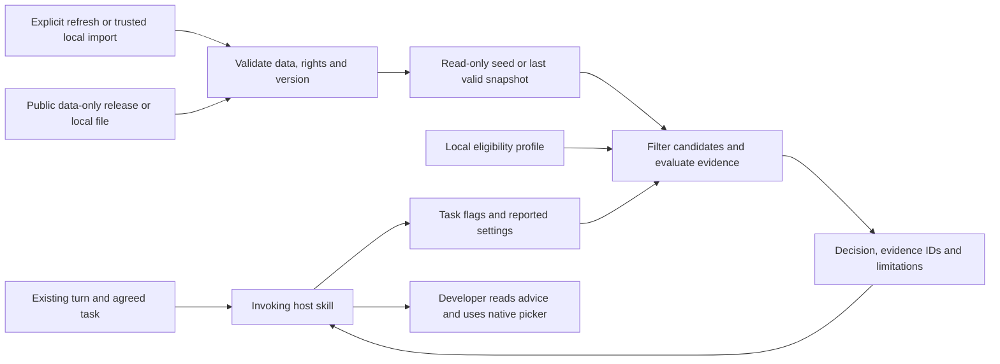

# ModelPilot architecture review

**Run 1 · November 24, 2026 · Decision for the owner**

**Proceed to Run 2 planning once the owner accepts the product success criterion and names the release-test clients.** Build the case for a small, key-free advisor first. Its useful unit of output is an eligible action for the *next piece of work*, with a source, a reason and a clear limit on what was measured. A model switch is only one possible action.

Three findings materially change the design.

- An existing MIT-licensed skill, **Model Picker**, already gives task-specific model and effort advice in Claude Code and Codex. ModelPilot earns its place through verified availability, independently refreshable evidence and demonstrably better decisions. Use the existing skill as a baseline. [Model Picker][picker] · [Its actual decision instructions][picker-skill]
- I inspected 95 public Terminal-Bench submission files. The 52 rows for the two target agents contained **zero within-model effort pairs** at a fixed benchmark version and agent version. They did contain usable same-effort comparisons between models. A firm claim about optimal effort would need different evidence. The coverage audit below is reproducible. [Terminal-Bench 4.x snapshot][tb4-files] · [Terminal-Bench 2.1 snapshot][tb21-files]
- Artificial Analysis documents precisely the coding-agent endpoint we would want. It requires Pro or Commercial access. Its data terms also name third-party model-selection guidance as a restricted use. Leave it out of the V1 dependency chain, evaluation fixtures and public demo. [API reference][aa-ref] · [Data Platform Terms §§2.3–2.6][aa-terms]

**How to read the evidence.** **Documented** means a primary source describes a capability, contract or term. **Observed** means I read the specified file, ran the stated local metadata check, or inspected a public response in this run. **Proposed** marks a design choice, operational assumption or threshold the owner can change. **Untested** marks behavior that a native invocation, rights determination or controlled experiment must establish. Public sources were accessed November 24, 2026. A retrieval date is distinct from a release date, evaluation date or account verification. The [owner handoff](../ModelPilot-Skill-V1-Codex-Handoff.md) supplies the product decisions.

## Product understanding and critique

The decision happens after the developer and agent already understand a task, often just before implementation. “Which setting should I use for this agreed change, and is switching worth the interruption?” is more valuable than a provider-wide ranking. The skill can reuse the acceptance criteria, current progress and uncertainty in the conversation. A short, sourced answer can save the owner a separate research session even when it recommends keeping the current setting. Whether it improves the resulting work or saves time overall is **untested**.

| Existing solution | What it already does | What to reuse or test |
|---|---|---|
| Model Picker | Its canonical skill maps task/risk to tiers T0–T4, reads platform profiles and gives manual settings. Its documented installer uses Bash, a stable clone and symlinks. The author reports a possible slash-command collision. | Adopt the advice-only interaction as a baseline. Compare its instructions on equal footing. A Windows self-contained package, versioned evidence and explicit account uncertainty justify separate work only if they help users. A fork is viable if testing favors its rubric. [Repository][picker] · [Instructions][picker-skill] |
| Built-in pickers and provider guidance | Both hosts already let the user select model and effort. Anthropic even teaches when to change each dial. | Point back to the native selector. Reuse providers’ capability descriptions as attributed guidance. Measure how often the skill adds a decision beyond what the selector and an ordinary question already provide. [Codex models][cx-models] · [Claude Code model settings][cl-model] · [Anthropic effort tutorial][cl-academy] |
| Artificial Analysis Model Recommender, REST and MCP | Its existing web recommender compares intelligence, speed and cost preferences. REST and MCP expose data under the caller’s tier. | Consider the documented schema when defining evidence fields. A remote lookup still leaves local eligibility, task fit, switching cost and rights to resolve. [Web recommender][aa-picker] · [REST reference][aa-ref] · [MCP][aa-mcp] |
| Models.dev and RouteLLM | The former publishes structured model metadata. The latter routes live requests between models using trained routers and a cost/quality threshold. | Use Models.dev as a secondary discovery source. Borrow RouteLLM’s idea of comparing against fixed policies. Its traffic routing, infrastructure and training assumptions solve a different decision. [Models.dev source][md-readme] · [RouteLLM][routellm] |

**Failure criterion.** If the output usually repeats the host default, adds an unsubstantiated preference, or takes longer to interpret than opening the picker, stop expanding the catalog. An honest negative evaluation of two existing approaches is also a credible portfolio result. A useful portfolio release should let a reader reproduce at least one decision, one abstention and the comparison against a meaningful baseline using shareable inputs.

## Requirements review

| Standing | Scope and rationale |
|---|---|
| Owner decisions | Both hosts are first-class and independently usable. Windows personal use comes first. Advise on demand using existing context. Default to this platform, permit explicit/configured cross-platform comparison, respect suitability and risk, and keep manual control. Model intelligence must update within the supported schema without a skill reinstall. No additional external processing of project context by default. |
| Defaults I support | One source of instructions and policy, a small curated catalog, local operations, explicit unknowns, project-scope testing and a genuine “keep current” outcome. |
| Changes I recommend | Use deterministic eligibility and evidence checks with a small set of decision rules. Separate advice from network refresh. Provide one advisory entry point with conversational qualifiers. Use official guidance for reversible trials and reserve measured comparisons for matched evidence. |
| Defer | Continuous hooks, automatic switching, background refresh, account/quota scraping, usage dashboards, Antigravity integration, a hosted backend, context transfer, per-milestone allocation, broad vendor coverage and a general-purpose ranking engine. An explicit comparison between the two configured hosts remains in scope. |
| Open decisions | The minimum benefit over existing advice, exact Windows acceptance surfaces, preferred catalog delivery route and later evaluation allowance appear in the decision register. |

**Invocation.** Use `$modelpilot` in Codex and `/modelpilot` in Claude Code. The default is the current actionable task. “For the next agreed task,” “effort only,” “compare these two,” and “include my other platform” are ordinary text. Honor `next`, `effort`, `compare` or `global` when used with those meanings. Only an explicit refresh request opens the data-update path. A discussion with several future milestones gets advice for the next named boundary. An unclear referent that would change the result merits one short question. Explicitly selecting the skill must end the turn with advice, including when the underlying task is phrased as an imperative. [Codex skill invocation][cx-skills] · [Claude Code arguments][cl-skills]

**Example reply.** Assume the developer has confirmed Claude Fable 5.2 at `high` in Claude Code, the next change is well specified, and a check exists for the result. The example uses provider guidance reviewed November 24, 2026.

> **Keep Fable 5.2 at high for the current change.** The provider recommends high as a starting setting for this model. I found no matched high-versus-medium result for your kind of change. At the next independent edit, medium is a reasonable trial if your picker offers it. Use the existing acceptance check before repeating that choice. [Anthropic’s model-specific effort guidance][cl-effort]

That reply uses an action, an evidence limit and an observable trigger. With no verified active model it would say “If your picker shows Fable 5.2 at high …”. A release without independent measurements can appear as a new supported option while its comparative performance remains unknown.

## Environment and host feasibility

**Observed locally.** The working directory contained the 47,936-byte handoff as its only entry at inspection. `git status --short --branch` reported no Git repository in this directory or its parents. There was no existing product code, package manifest, review or repository instruction file to reconcile. I used command discovery, version/help flags and Windows package metadata. These observations establish which binaries were accessible from this PowerShell session.

| Surface | Observed on this machine | Documented path and behavior | Untested native boundary |
|---|---|---|---|
| Codex | Windows desktop package `26.1117.4957.0` x64. Bundled `codex-cli 0.171.0-alpha.13`. Help advertises model selection, sandbox policies and experimental App Server tooling. | Project `.agents/skills/modelpilot/` and user `~/.agents/skills/modelpilot/`. Repo discovery walks from the working directory to the repo root. Duplicate names can both appear. CLI/IDE support a `$` mention or `/skills`. The desktop composer also documents `$`. Changes are detected automatically, with restart as a fallback. `agents/openai.yaml` can set `policy.allow_implicit_invocation: false`. [Skills][cx-skills] · [Desktop composer][cx-app-slash] | Confirm the local desktop picker, current/next context, script path, permission prompt and independent operation. Exercise the CLI separately. Treat trailing words as prompt text until the installed clients demonstrate their behavior. |
| Claude Code | Native `claude 2.1.325`. Help advertises `--model` and `--effort` and lists `low`, `medium`, `high`, `xhigh` and `max`. These are client vocabulary. | Project `.claude/skills/modelpilot/` and user `~/.claude/skills/modelpilot/`. Local `/modelpilot` runs inline by default. `$ARGUMENTS` is substituted or arguments are appended. `disable-model-invocation: true` allows explicit use. The client watches skill directories outside bare mode and documents `/reload-skills`. [Skills][cl-skills] | Confirm literal slash selection against the built-in `/model`, scope, path resolution and behavior on first install. Test the installed build, including whether a reload or fresh session is necessary. |
| Windows runtime | Windows NT `10.0.26200.0`, PowerShell `7.6.9`, Node `v24.14.0`. | Codex offers Windows sandbox and network controls. Native Claude Code can use PowerShell, with Git Bash available through Git for Windows. Anthropic documents shell sandboxing on WSL2, macOS and Linux and unsandboxed shell commands on native Windows. Host permission controls still matter. [Codex Windows sandbox][cx-win] · [Claude Code setup][cl-setup] · [Claude shell sandbox][cl-sandbox] | Node on this shell’s PATH does not establish the desktop or Claude shell PATH. Test spaces, Unicode, read-only checkouts, denied execution/network and a missing runtime. WSL has its own filesystem, home and toolchain. |

**Current settings and eligibility require different evidence.** Codex App Server documents a paged `model/list` with `id`, `model`, `hidden`, `inputModalities`, `defaultReasoningEffort`, `supportedReasoningEfforts` and `nextCursor`. This belongs to a client connected to the relevant server, account and selected provider. Thread/turn options can override defaults. No documented bridge from an arbitrary local skill into its invoking desktop connection was established. Never start a second session to infer the first session’s state. Use an explicitly supplied same-session setting, otherwise accept a user-confirmed picker value. Codex CLI documents `/model` for manual changes. [App Server][cx-server] · [CLI model controls][cx-commands]

Claude provides a narrower opportunity. Local skills document a `${CLAUDE_EFFORT}` substitution and `${CLAUDE_SKILL_DIR}`. The documented substitution list gives no equivalent active-model ID. The user can see the model with `/status` or an existing status line and inspect effort with `/effort status`. Auto/unset, administrator caps, aliases, plan mode and fallbacks complicate “current.” Treat a substituted token as the **reported** effort until its semantics on auto/capped sessions have been checked. A stale profile is a preference, never a live reading. Ask for only a model/level when needed, never a status dump. Native picker selections may persist. Point to the session-only control when appropriate. [Claude skill variables][cl-skills] · [Model and effort resolution][cl-model] · [Status line contract][cl-status]

**A picker label can change the execution method.** Codex documents Ultra as using parallel subagents. Claude Code documents Ultracode as an orchestration toggle that can accompany different effort levels. Treat these as host-specific execution modes, outside ordinary effort-only changes in V1. An observed run with either enabled cannot be silently matched to a single-agent effort result. [Codex models][cx-models] · [Claude Code effort settings][cl-model]

**Proposed portability boundary.** Use the common Agent Skills directory and required `name` and `description`. Produce two small installation variants from one body. The Claude variant adds its manual-invocation flag and optional read-only effort hint. The Codex variant adds its invocation-policy metadata. Neither sets a model, effort, tool preapproval, hook or forked context. The documented format permits bundled resources. Actual context continuity and native command dispatch remain independent tests on both hosts. IDEs, hosted cloud and WSL are separate compatibility claims. [Agent Skills specification][spec] · [Codex skills][cx-skills] · [Claude skills][cl-skills]

## Data source evidence matrix

**Key-free means no additional intelligence-provider account.** Each native host still requires its usual access. The sources below answer different questions. Preserve source type, scope and date at the field level so a host support statement cannot silently become a performance observation.

### Platform and provider sources

| Source and verification | Fields, units and limits of coverage | Access, update behavior and reuse |
|---|---|---|
| Agent Skills, Codex skills/App Server, Claude Code skills/model settings · **Documented** | Frontmatter, invocation, directory scope and authored host controls. App Server’s picker schema and Claude’s reported-effort substitution are described above. Zero task-quality measurements. | Public docs, no key. Client changes and administrator policy matter. App Server is an initialized client protocol with cursor pagination, outside the key-free refresh feed. No public-doc numeric fetch quota or update SLA established. Store original compatibility notes, source links and client version. The spec repository assigns CC BY 4.0 to documentation and Apache-2.0 to code. Vendor manuals have their own terms. [Spec][spec] · [Spec repository][spec-repo] · [Codex App Server][cx-server] · [Claude model configuration][cl-model] |
| OpenAI selection, reasoning, models, lifecycle and pricing · **Documented** | API `GET /v1/models` supplies `id`, `created`, `owned_by` and optional `shutdown_date`. Model pages and reasoning guide describe supported controls. Pricing has input, cached input and output rates, with model/service-tier units. Codex documents separate availability. One published retirement even distinguished ChatGPT-authenticated Codex from API-key access. | Public pages are key-free. API listing uses a bearer credential and applicable organization/project limits. No reliance on it in V1. Record the effective price date or mark it unknown, API tier, currency and unit. Check deprecations separately. Use original fact notes/links with reviewed scope. No blanket grant to mirror pricing tables established. [List Models][oai-list] · [Selection][oai-select] · [Reasoning][oai-reason] · [API pricing][oai-price] · [Deprecations][oai-dep] · [Codex models][cx-models] · [Rate limits][oai-rate] |
| Anthropic model overview, effort, pricing and lifecycle · **Documented** | `GET /v1/models` model IDs, capabilities, context limits and lifecycle fields. The response example has `capabilities.effort.<level>.supported`. Provider/model-specific IDs and effort defaults matter. API prices distinguish input, cache writes/reads and output. Claude Code permissions, aliases, account and effective effort are separate. No controlled outcome per level follows from the flag. | Pages are key-free. The API supports an authorized `x-api-key`, the `anthropic-version` header and ID-based pagination. Limits vary with tier/workspace and resource. Recheck retirements, prices and host controls separately. Original sourced notes or links for the seed. Raw tables and long quotations need a rights basis. [Model overview][cl-overview] · [List Models][cl-list] · [Effort][cl-effort] · [Pricing][cl-price] · [Deprecations][cl-dep] · [Limits][cl-rate] |
| Google Gemini, optional external tool · **Documented** | `GET /v1beta/models` and `/v1beta/models/{model}`. Fields include `name`, `version`, `inputTokenLimit`, `outputTokenLimit` and `supportedGenerationMethods`. The thinking guide distinguishes model-dependent thinking levels and budgets. Preserve their native types. An API model card gives neither a coding-agent seat nor a comparable effort run. | Public guide and prices are key-free. The API supports a project key (`x-goog-api-key`), page tokens and project/tier quotas. Use a link-only external candidate until an actual tool, account and permitted facts are configured. Apply CC BY 4.0 only to Google documentation carrying the relevant notice and observe exceptions. [Gemini models][g-models] · [Methods][g-api] · [Thinking][g-thinking] · [Prices][g-price] · [Limits][g-rate] · [Site policies][g-terms] |

For the three provider lists, this review did not verify a universal numeric quota for the metadata endpoint. Inference-token quotas are a different limit. None of those authenticated endpoints is required for key-free advice or catalog import. [OpenAI limits][oai-rate] · [Anthropic limits][cl-rate] · [Gemini limits][g-rate]

### Independent measurements, reusable metadata and methodology

| Source and verification | Granularity and gaps | Access, freshness, cache and redistribution |
|---|---|---|
| **Artificial Analysis (AA), model list** · **Documented**, no API calls | `GET /api/v2/language/models/free?page=1` returns paged IDs/slugs, release date, index version, headline indices, input/output prices, headline performance and limited index cost. `/api/v2/language/models` is tier-shaped. The Free subset omits full per-benchmark scores and task time. A model variant label is insufficient for a host-specific effort comparison. | All tiers require a key via `x-api-key`. Free 100 and Pro 500 REST requests per fixed 24-hour window, Commercial negotiated. Observe rate-limit/reset headers and `Retry-After`. Source updates as AA publishes. AA schedules legacy performance fields to become null December 10 and v1 to return 410 December 16, 2026. Track methodology as well as wire version. Rights below. [API and transition dates][aa-doc] · [Reference][aa-ref] |
| **AA coding-agent data and MCP** · **Documented**, row coverage **untested** | `GET /api/v2/language/agents/coding?page=1` is Pro+. Documented record has agent, `model.effort`, `coding_agent_index_version`, component results, USD `cost_per_task`, `time_per_task_seconds` and token fields. `variant_of` can share averaged scores. Null index and incomplete components matter. Exclude shared averages, routed models and unresolved harness mappings from direct effort comparisons. | Free receives 403 for this endpoint. MCP at `https://mcp.artificialanalysis.ai/mcp` uses OAuth sign-in or a key. Signed-in MCP is documented at 200/1,000 calls for Free/Pro per window. Keyed MCP uses the REST quota. Transport does not change tier or rights. A licensed user would still have to demonstrate coverage of both sides of a proposed comparison. [Endpoint schema][aa-ref] · [MCP][aa-mcp] · [Tier details][aa-plans] |
| **Models.dev** · **Documented + observed public JSON** | `GET https://models.dev/api.json`. Provider-keyed models, IDs, `reasoning_options`, modalities, limits, costs and release/update dates. Checked the actual controls below. Community-sourced metadata can nominate new candidates. It cannot establish a user’s selectable settings or task success. | No key for this feed. It returned an ETag. Update-on-contribution, no guaranteed quota or cadence established. Stable v1 omits the opt-in Codex subscription-provider entry available in experimental v2. Keep MIT copyright/license notices with covered material and verify upstream scope before bundling. Prefer a small reviewed subset over storing the entire feed. [Data format and endpoint][md-readme] · [Repository license][md-license] |
| **Terminal-Bench / Harbor** · **Documented + observed pinned aggregate submissions** | Public `leaderboard/submissions/*.json`. Source filter identifies model, agent/version and effort. Rows include resolution metric, confidence interval, trials and, when present, total USD, tokens and mean wall time. `none` can mean the agent reported no effort. Separate benchmark releases, regrades, budgets and trial definitions. Terminal work has limited transfer to UI taste or architectural judgment. | Public repo/raw GETs, no key. Commit-pinned rows are replayable. Publication/regrading is event-driven. GitHub REST’s usual unauthenticated primary limit is 60 requests/hour per IP, with additional secondary limits. Raw downloads are a different route. The inspected benchmark repositories declare Apache-2.0. Check notices for each imported artifact, especially task assets and third-party submissions. Prefer selected aggregate facts or links. [Row contract][tb4-setup] · [Submission semantics][tb4-submit] · [4.x license][tb4-license] · [2.1 license][tb21-license] · [GitHub limits][gh-rate] |
| **SWE-bench** · **Documented** | The Verified test split has 500 instances. Distinguish split, resolved fraction, underlying model, scaffold, submission and date. The bash-only view standardizes a scaffold. Effort, retries and billing often need separate submission evidence. The project’s entries reference submitter-controlled artifacts. OpenAI reports contamination and flawed tests in Verified, which limits its ability to distinguish frontier systems. | Public leaderboard and `SWE-bench/experiments/evaluation/<split>/<submission>/`, including `metadata.yaml` for modern entries. Updates follow submissions and change in eligibility rules. Same GitHub REST limit when using that API. Harness MIT license, dataset card and each submitter’s results are separate rights questions. No general scoreboard redistribution or cache term established. Link to specific entries until cleared. [Leaderboards][swe-board] · [Verified dataset][swe-data] · [Submission structure and eligibility][swe-exp] · [Harness license][swe-license] · [OpenAI audit][swe-audit] |
| **OpenAI skill eval guide / original owner trials** · **Documented method / proposed measurements** | The guide separates output, process and cost checks and demonstrates capturing execution events. It supplies no model-ranking feed. Original, consented task trials could supply the missing model/effort/harness pairs, with failures and retries included. | Guide is a public reference, no key or polling. Native trials consume host quota or API spend under the chosen account. Use original tasks with redistribution rights, synthetic fixtures for mechanics and shareable aggregate observations for the portfolio. Never ship personal traces. [Skill evaluation guide][eval-guide] |

**AA rights change the architecture.** Terms v1.1, revised August 19, 2026, distinguish internal use and limited attributed public citations from distributing structured raw data. Sections 2.4–2.5 restrict combining data for third parties and using it to develop or operate a third-party model-selection product without written consent. Section 2.6(d) separately addresses using data to develop or improve AI/ML systems. Section 11.7 requires deleting raw copies within 30 days after termination. I found no general cache TTL permission. The marketing tier table is insufficient grounds to ship a cache, mixed dataset or adapter for this product. Treat private decision support, development/tuning, display, retention and distribution as separate proposed uses. Seek written scope before relying on AA for any unresolved use, including a BYOK release. No AA benchmark data was ingested. [Data Platform Terms][aa-terms] · [API attribution guidance][aa-doc] · [Service tiers][aa-plans]

### What the public data actually covers

**Observed method.** I used unauthenticated HTTPS GETs against two public Terminal-Bench repositories. For each, I selected the last main-branch commit before `2026-11-24T00:00:00Z`, enumerated the JSON files in `leaderboard/submissions` and filtered on the exact `metadata.agent_display.label` values `Claude Code` and `Codex`. Within a benchmark version I grouped by `source_filter.agent`, `agent_version` and full `model_name`, then counted distinct `metadata.reasoning_effort` labels. I treated missing 4.x leaderboard targets as `4-0-0` per the maintainer’s contract. I inspected metadata and aggregate metrics, without opening trial traces. Raw ID matching is deliberately conservative. Alias merging or relaxed host matching answers a different question. [4.x commit ad4c7aa][tb4-files] · [2.1 commit 12b7565][tb21-files] · [4.x default and effort semantics][tb4-submit]

| Pinned submission set | All JSON rows | Claude Code | Codex | Groups with two or more effort labels under that match |
|---|---:|---|---|---:|
| Terminal-Bench 2.1 | 20 | 5 rows · 2 max, 1 xhigh, 2 high | 6 rows · 5 max, 1 xhigh | 0 of 11 |
| Terminal-Bench 4.0 and 4.1, grouped separately by version | 75 | 29 rows · 28 max, 1 none recorded | 12 rows · 10 max, 2 xhigh | 0 of 41 |
| **Total** | **95** | **34** | **18** | **0 of 52** |

One loose match on 4.0 would put two Claude Code rows labelled GLM-5.3-Flash together. The exact source configurations differed, and one carried the no-effort-reported label. This illustrates how a join on display names can manufacture an apparent experiment. These counts cover the two inspected snapshots only. They leave open the existence of effort sweeps in other sources, private experiments or future submissions. [Pinned 4.x entries][tb4-files] · [Submission rules][tb4-submit]

**There are real comparisons worth surfacing.** On Terminal-Bench 4.1, Codex `0.169.0` at `max` recorded 61.52% for GPT-6.2 Sol and 62.12% for GPT-6.2 Astra across 330 trials each. The published 95% interval half-widths were 2.75 and 2.30 percentage points. The data support showing both measured results. Establishing statistical equivalence or a decisive quality gain would require a suitable comparison design. On Terminal-Bench 4.0, the two Claude Code `2.1.284` max-effort submissions for Opus 5.5 and Sonnet 5.5 each report 330 trials. Their total measured API costs were $4,718.65 and $7,333.64 respectively. This is a concrete reason to inspect completed-task economics before inferring savings from a model’s list price. The source aggregates costs across all trials, including disqualified ones, and records model release dates separately from run timing. These figures belong to those workloads and harnesses. [Sol record][tb-sol] · [Astra record][tb-astra] · [Opus record][tb-opus] · [Sonnet record][tb-sonnet] · [Aggregation contract][tb4-setup]

**Metadata check.** The public Models.dev v1 response contained 42 OpenAI API model records and 18 Anthropic API records. Of those, 29 and 14 respectively had a nonempty `reasoning_options` entry of type `effort` with enumerated values. Neither provider had a model record with a top-level key named for an evaluation or benchmark. The v1 `openai-codex` provider key was absent. The response SHA-256 was `166d660d09ccc218ce0e3d234db1f88f8155b622fcc1735bbd9875e651f0c360`. These are API catalog counts, including older records, with no account filter. They show why tracking controls and measuring their effectiveness require different sources. [Public feed][md-feed] · [Documented v1/v2 scope][md-readme]

**Minimum viable evidence.** Key-free inputs can support eligibility checks, dated provider guidance and some same-effort model comparisons. They cannot support a general table of optimal effort by task. For a reversible task with a concrete acceptance check, a named provider default or a one-step trial can be useful if labelled as guidance. For consequential work, weakly related results, or an untestable change in effort, hold the known suitable setting or abstain. Record coverage as a deliverable in its own right. If both hosts lack enough actionable cases to beat the baselines below, the product case fails even if the software works.

**Fit by task.** A terminal failure with a reproducible test is a plausible use for a matched Terminal-Bench row. A repository patch may be closer to a specific SWE-bench split. Neither source directly evaluates visual design judgment, architecture tradeoffs, security-review completeness or documentation clarity. For those tasks the catalog can establish modality, tool support and provider guidance. A comparative quality claim needs an original task and a rubric appropriate to that work.

## Architecture alternatives

| Approach | Invocation cost and repeatability | Portability, refresh and rights | Decision |
|---|---|---|---|
| Instructions plus live web research | Lowest build cost. Each invocation spends host tokens/time finding sources and interpreting their comparability. Answers can change with search results. | Broad host support when research is permitted. Offline evidence is limited to whatever was bundled. Allowlisting generic lookups is harder to enforce in a free-form search. Public readability alone gives no right to redistribute results. | Good web-enabled baseline and occasional human investigation. Weak default. |
| Instructions plus a small reviewed evidence file | Very little machinery. The host can cite the same cards each time but can still misjoin an effort, lose an eligibility rule or favor itself. | A copied folder and separately replaceable file suffice. Works with blocked shell execution. Rights review is bounded to a few records. | Strong fallback and the diagnostic comparison for whether any script earns its cost. |
| **One skill with a small local decision function and a data-only catalog** | One local lookup on an ordinary request. The same normalized input and snapshot give the same decision and allowed citations. Task interpretation still varies by host. | One external runtime, standard library only. A bundled seed works without network. One reviewed artifact can update both installs independently. Permissions/rights stay with each source. | **Recommended for planning.** This earns its runtime only if tests show it prevents consequential errors or saves enough user effort. |
| Live intelligence MCP or a hosted router | Remote tool selection, I/O and another point of failure. Current measurements can be valuable, but the tool still needs local host and task information to make a useful choice. | Adds setup, network, credentials and upstream tiers. MCP carries the arguments the host sends. A router handles user work directly. Neither can be the sole independent/offline path. | Keep remote intelligence outside the default design. Reconsider an adapter only with adequate rights and measured incremental coverage. [AA MCP][aa-mcp] · [RouteLLM][routellm] |

**Why a deterministic part at all?** Scope, capability requirements, identity, evidence matching, tie behavior and citation selection have checkable answers for a given input. Repeating that work in two prompts introduces variation where it gives the product no benefit. Task boundaries and whether “review this design” calls for visual judgment or code inspection are contextual. The host already has that context. There is little benefit in passing it to another model or building a classifier. Keep the on-disk catalog readable so the simpler alternative stays viable.

### Conceptual data flow



Only the update path contacts a catalog origin. The advisory path accepts a local snapshot and cannot issue network requests. A refresh request has no task argument. A future interface could reuse the catalog and the input/output contract without acquiring any hook into a conversation.

### Proposed package layout

```text
skills/modelpilot/
  SKILL.md                   canonical instructions
  scripts/recommend.mjs      pure decision rules and local entry point
  scripts/catalog.mjs        catalog validation, reading and explicit refresh
  assets/seed.json           small rights-reviewed catalog with provenance
  references/                brief manual fallback and source notices
packaging/
  claude/                    invocation-only frontmatter and effort hint
  codex/agents/openai.yaml   explicit invocation policy
tests/
  fixtures/                  original synthetic configurations and failures
  evals/                     shareable prompts, rubric and pinned evidence IDs
docs/                        decisions, coverage audit and evaluation report
```

This is a packaging proposal. A release contains a complete `modelpilot/` directory for each host. Build-time assembly may inject a header or metadata file. Verify that the policy, schema, seed and scripts in the two finished folders have identical hashes. Scripts and assets resolve from the installed skill directory. A second source tree, database, installer framework or service would add little at this size.

## Recommendation method and contracts

**Smallest useful taxonomy.** Ask the host to extract one immediate objective and a few constraints. Use broad task families such as implementation, diagnosis, review/design, research/explanation and writing/testing. Separate *requirements* from the family. “Fix this button’s spacing” and “decide which interaction makes the dashboard usable” can share a frontend repository while requiring different evidence. For mixed work, assess the next agreed boundary. A “security” or “architecture” keyword alone supplies no evidence that maximum effort helps.

| Contract | Proposed contents |
|---|---|
| Context supplied to the local policy | Host/surface, intent (assess, compare, effort-only), scope, current/next boundary, task family, ambiguity, impact if wrong, reversibility, validation available, progress (new/underway/blocked), needed modalities/tools/context and priority (balanced, time or cost). Unknown is a permitted value. The host keeps the natural-language interpretation for its reply. Free-text prompts, code, paths and conversation IDs stay out of the contract. |
| State and eligibility | Separate provider identity, host-selectable ID, immutable revision when known, route/alias and validity interval. Effort is native and typed as explicit, auto/default, unsupported or unknown. Store current model and current effort with **independent** origins and observation times. Profile records identify host/surface, allowed models/levels and restrictions for a user-selected profile. Label same-session observation, current user confirmation, dated profile, documented support and unknown distinctly. |
| Catalog and evidence | Each snapshot has schema version, data version, creation time, digest and rights metadata. An evidence ID resolves to its source URL/revision, publisher type, claim type, publication/evaluation/retrieval dates, license/use scope, model and effort as measured, and matching limits. A measured run also carries benchmark/revision/split, harness/version, tool and budget settings if known, workload, repetitions, aggregation, metric direction, unit, dispersion and missing fields. |
| Economics | Prices are a separate table keyed by model/provider, service tier, currency, token category, unit and effective date. A run can report measured USD, wall time, retries and token counts against an explicit denominator (trial, task, successful task, full suite). Unknown billing mode suppresses price-based advice. Where the user identifies an applicable credit-billing plan, store its published credit unit separately. Codex publishes token-denominated credit rates, and says included allowance also depends on how the tool is used. A subscription profile can omit prices entirely. [Codex usage and pricing][cx-usage] · [Claude plan usage][cl-usage] |
| Result | Action (stay, adjust effort, change model, external alternative, conditional, insufficient), scope and timing, current/configuration references, grounds (requirement, matched measurement, provider guidance), evidence IDs, disqualifiers/unknowns, material switching cost and one manual next step. Record policy and snapshot versions for replay. Use stable ordering only for presentation. |

**Example of the boundary.** This synthetic fixture contains no real performance claims. Here the user has confirmed a model but left effort to its host default. The host can render “For the next well-defined implementation, keep the model. Its default is a supported starting point. We have no matched lower-effort run.” A reference ID marked as a fixture can never appear in a production recommendation.

```json
{
  "input": {
    "host": "codex", "intent": "effort-only", "scope": "current-platform",
    "boundary": "next", "family": "implementation", "impact": "low",
    "ambiguity": "low", "reversible": true, "validation": "automated",
    "progress": "new", "requires": ["text"], "priority": "balanced",
    "current": {
      "model": {"id": "fixture/m1", "origin": "user-confirmed"},
      "effort": {"mode": "host-default", "value": null, "origin": "user-confirmed"}
    },
    "eligibilityProfile": "fixture/local", "snapshot": "fixture/v1"
  },
  "result": {
    "action": "stay", "scope": "current-platform", "timing": "next",
    "model": "fixture/m1", "effort": {"mode": "host-default", "value": null},
    "grounds": "provider-guidance", "evidence": ["fixture/default-guidance"],
    "limitations": ["no-matched-effort-pair"], "policyVersion": "fixture/1"
  }
}
```

**Decision rules, in order**

1. **Set the boundary.** Honor “effort only” by fixing the model. Fix the platform except on explicit authorization or a deliberate user preference. A configured external option also needs a confirmed tool and account. Never transfer context as a side effect of comparison.
2. **Filter hard constraints.** Intersect documented support, current eligibility and task requirements. Honor explicit prohibitions first. A current picker confirmation can resolve stale profile data. A documented retirement or conflicting fresh observations call for rechecking the applicable host/route. With uncertain access, show a conditional option. With a known incompatible current model, explain the missing requirement even if no replacement qualifies. A firm capability-based change can be warranted without performance scores, for example when only one eligible option accepts the required input.
3. **Establish which claims the evidence can carry.** A direct comparison needs matched benchmark/split/revision, outcome/unit, harness/tool and budget conditions, identifiable model revisions, and an applicable task family. To attribute a difference to effort, fix model and harness and vary the effort. To compare models, preserve native settings and disclose what changes. A whole-host comparison may compare two complete configurations on a common task, but cannot isolate a model effect. A shared average, vendor aggregate, unmatched budget or unreported effort gives directional context at most. An alias without a resolved revision limits the claim. Treat `null` as unknown, never as a zero score, unsupported capability or free price.
4. **Apply suitability before efficiency.** Require a task-specific quality floor or hard requirement. Express the floor in terms of an observable outcome, such as preserving the required acceptance tests and review criteria. If comparable quality is established, use measured time/cost consistent with the user’s priority. Retain multiple options when quality and time trade off. Define a meaningful margin for the workload *before* reading scores. Tiny differences, conflicting evidence and overlapping marginal intervals do not establish a decisive gain or equivalence. No normalized leaderboard, invented probability or effort multiplier.
5. **Account for progress.** For a near tie, keep a known suitable current setup. Consider an effort-only change at the next boundary before proposing a disruptive model or host change. In-progress edits, cache reuse, repeated work and manual reconstruction of context add friction, usually unmeasured. If no current configuration is known, “stay” is unverifiable. Give a conditional recommendation, ask the one picker question that would change it, or abstain.
6. **Explain strength in plain language.** “Measured on this workload” supports a scoped comparison. “Provider guidance” can justify a reversible trial with a check. “Insufficient evidence” identifies the missing comparison or access fact. When quality stakes are high, indirect data cannot justify a downgrade. A practical output leads with one action, then up to two source-linked reasons, a freshness caveat if material and a manual next step. The renderer may shorten the text but must use the returned evidence IDs, action and qualifiers.

An important negative control is a catalog containing only maximum-effort rows. It should still yield useful capability filtering, model comparisons at that setting where justified, and explicit coverage gaps. It provides no basis to impute values at medium. Conversely, a genuinely matched, low-risk case that meets the quality floor and shows a material speed advantage should produce an actionable change. An engine that always abstains fails the latter test.

## Refresh, portability and installation

**One reviewed data artifact, independent of the skill version.** For personal use, a maintainer can prepare an updated catalog from public, permitted sources and the owner can explicitly import the file. The same artifact can later be fetched from a fixed HTTPS release location under the project’s control. Static file distribution needs no running ModelPilot service. The file contains original annotations, permitted facts and source references. Code, prompts, path directives and executable templates are outside the data format. New entries and retirements within a supported schema take effect immediately after a valid import. A new schema capability may require a skill update. The maintainer and date of the last substantive review should be visible.

| Data class | Proposed personal-use freshness policy | What happens at the boundary |
|---|---|---|
| Host support, aliases, lifecycle and eligibility | Recheck mutable support notes after 7 days. Give in-session picker confirmation precedence for the user’s effective route. Profile permissions/denials persist until changed, while old access observations age. | Flag stale access. Withhold an unconditional new selection until revalidated. A known applicable retirement blocks a candidate. A fresh fetch cannot establish current account access. |
| Prices | Recheck active price records after 7 days, on a known rate change, or before making a price-based decision. | Suppress a decisive economic claim if dates, units, service tier or billing mode are missing. Keep independent capability advice available. |
| Measurements | Pin original result revision, benchmark/harness and evaluation date where published. Check the source index for regrades, withdrawals and new coverage after 30 days. | Historical measurements remain historical. A newer revision supersedes only its matching record. A benchmark’s display date may be a model release date. Preserve an unknown evaluation date. |
| Source rights and delivery | Record rights per field/artifact and intended use (internal, link-only or redistributable). Recheck on terms changes and before public release. | An expired permission or withdrawal can override last-known-good fallback for that source. Omit restricted rows and keep unrelated eligible evidence. |

These intervals are **proposed review reminders**, adjustable after observing change rates. Ordinary advice performs a local age check without network traffic. Explicit refresh/import checks a fixed origin or a user-selected trusted file. A key-free installation includes a dated, rights-reviewed seed for both hosts. If performance rows lack clearance, ship original host guidance and source links, plus a clearly separate synthetic demonstration. With no usable real seed, the live path reports missing evidence and explains how to import it. Demo mode is explicit and cannot be selected by a lookup failure.

**Update integrity.** Check schema compatibility, source/rights allowlists, size, dates, identities, units/ranges and duplicate/conflicting entries before promotion. For paged upstreams, bound pages and total bytes, require completion against pagination metadata, detect repeated cursors and preserve prior rows on a truncated result. A missing row alone is insufficient evidence of retirement. When sources conflict, the host controls host availability and the provider controls its API pricing. If equally authoritative facts conflict, withhold that field. A 304 can update the last check time only. Preserve the source’s effective/evaluation date separately.

Download/import into a same-volume staging file, validate it, then replace a small active-snapshot pointer atomically. Serialize writers per host cache, prevent older refreshes winning a race and let readers finish on their original immutable snapshot. Bound retries and timeouts, honor 429/reset, and stop on authentication, tier or rights failures. On partial upstream failure, keep the prior valid source block with its original timestamps and mark the failure. If referential integrity fails across blocks, reject the proposed combined snapshot. Preserve a last valid compatible generation and its digest, except where rights/revocation forbid reuse. Test Windows locked-file and crash behavior. Unknown schema, corrupted pointer, expired rights or an unavailable network should still produce a comprehensible local answer.

**Installation and state.** Proposed supported script runtime is **Node.js 24.x on PATH**, using only standard-library modules. No credentials for the core, package manager, compiler, MCP server or model-vendor SDK. Node was present locally. The host’s own login or quota remains its responsibility. If running the script is denied or Node is missing, the same skill can use a short, dated fallback reference for support and provider guidance, label the reduced evidence, and abstain from unverified comparisons. Never install a runtime during advice. [Node release schedule][node-releases]

- **Project test copy.** Install the complete host-specific folder under the project paths in the feasibility table, once per host under test. Keep test state in an explicitly authorized disposable directory. No junctions, symlinks or absolute paths back to the developer checkout. Resolve bundled files relative to the installed entry point. Pin/verify package version, hashes and collision-free skill name.
- **Optional personal copy and per-host state.** Later writes would go to `~/.agents/skills/modelpilot/` or `~/.claude/skills/modelpilot/` and, if approved, `%LOCALAPPDATA%/ModelPilot/<host>/` for snapshots and an optional user-edited profile. A possible Unix convention is `$XDG_CACHE_HOME/modelpilot/<host>/` and `$XDG_CONFIG_HOME/modelpilot/<host>/` with standard home-directory fallbacks. These are proposed destinations. Per-host copies trade small duplication for independent removal, permissions and schema rollback. Both can import the same data hash when comparing results.
- **Safe replacement and removal.** Refuse to overwrite an unrelated same-named skill. Verify ownership marker, expected root and file hashes before an update. Stage the replacement, preserve a locally edited copy for the user and retain a known-good package until the replacement loads. Removal targets only the verified installation for that host. Offer the owner a separate choice about its profile/cache. Uninstalling one host never removes the other’s files. No edits to either host’s global configuration are needed.

## Security, privacy and operating costs

| Boundary or failure | Design response and residual cost |
|---|---|
| Host conversation → local operation | Extract enums, booleans and catalog IDs only. Pass structured input over stdin where the host provides a safe data channel. Where the host exposes shell text only, use a fixed command and a closed grammar of validated tokens/IDs. Never interpolate raw prompts, paths from a task, JSON supplied by the model, or skill arguments into shell syntax. Use the installed script’s trusted path with platform-safe argument handling. Allow a manual fallback if safe invocation cannot be demonstrated. |
| Catalog origin → host | Refresh accepts inert typed fields from exact allowed HTTPS origins, bounds redirects/size/time and rejects unknown executable content, local paths and unsafe URL schemes. Treat external titles and text as untrusted. Render links from validated provenance. Store a digest and origin for reproduction. A checksum served beside a compromised file cannot authenticate it. Start with an explicitly trusted local import. For unattended trust in a mutable distribution channel, require independently authenticated release/digest or a signature before enabling that channel. |
| Workspace → personal state | A project can supply a malicious same-named skill or a fabricated eligibility file. Keep personal restrictions in a user-owned location. A repo can narrow its own candidates but cannot lift user restrictions, opt into cross-platform sharing, or redirect the update origin. No full-repository scan or private status/log inspection. Use ordinary filesystem permissions. Native Windows Claude shell isolation is limited, so narrow inputs and review of installed code matter. [Claude sandbox][cl-sandbox] |
| Network and secrets | Advisory code has no network path. Explicit refresh sends fixed, task-independent requests. The public origin can see IP, time and ordinary HTTP headers. Host inference still processes context under the host’s service terms. Default diagnostics contain source/status/version only. No telemetry or persistent recommendation log. If a later licensed adapter uses a key, only its refresh process should receive it via an approved credential mechanism. Never echo, persist, forward on redirect, or request a key inside the conversation. |
| Permission denied, stale cache or conflicting identity | Respect host policy and keep the original limitation visible. A blocked refresh returns the last permitted data with dates. A blocked executable reduces the assurance of the answer. A changed alias, ambiguous picker route or unresolved account profile yields conditional advice. Obtain explicit permission for installation or additional network scope when needed. |
| Counting cost | An invocation consumes the current host’s tokens/time plus at most one local advisory lookup in the normal path. Refresh consumes bandwidth, source quota if applicable, and maintenance time. A source-free demo and local imports have zero incremental intelligence-API charges. AI subscriptions can still consume allowance. Show observed API charges only with their invoice/run basis. Rate × token estimates, measured suite cost, wall time and subscription usage require separate labels. [OpenAI API rates][oai-price] · [Claude pricing][cl-price] |

Treat usage reductions as a hypothesis. Track advice latency, number of tool calls, added context, failure/retry time and the cost of curation. Cache only material allowed by source rights. A frequently refreshed catalog that takes an hour of owner maintenance to save minutes of research would fail the personal-use objective.

**Optional data has a real budget impact.** AA’s public pricing page displayed $417 per month per Pro seat alongside annual-billing savings on the review date. Commercial pricing is by quote. Confirm the billing cycle and permitted use before any future budget decision. The proposed core carries no AA subscription charge. [AA pricing][aa-price] · [API tiers][aa-plans]

## Testing and validation strategy

**Three questions deserve different tests.** Does the software enforce its contract? Does a user get better advice than the alternatives? Does following that advice improve work outcomes? Passing the first question provides no measured answer to the other two. The following counts and thresholds are **proposed**, and no native, recommendation or downstream outcome test was run in discovery. [OpenAI skill evaluation guide][eval-guide]

### Contract and refresh checks

Use original fixtures with invented IDs and units. Assert identical structured decisions for the same inputs/snapshot, allowing wording differences in host prose. Cover exact/alias IDs, retroactive alias changes, unknown/unsupported/auto effort, stale profile, hard denials, retired candidates and mismatched benchmark/harness/units. Include tied quality with lower measured cost, missing price, unknown currency, contradictory results and an eligible current setting that fails a hard requirement. Explicitly test “always cheap,” “always max,” “always stay,” and “always abstain” as losing policies on appropriate cases.

Exercise partial pagination, 401/403/429, timeouts, changed schema, corrupt downloads, stale blocks, concurrent refresh/read, a locked Windows file and a crash immediately before and after promotion. Include restricted-source removal and schema rollback. Use a local request-capture fixture with synthetic canaries to assert that advice makes zero intelligence requests and refresh emits no task text, paths, account data or canaries. Reject untrusted record URLs, oversized payloads and path/shell metacharacters. Require **all deterministic invariants to pass**, including scope confinement, immutable effort-only model selection, non-execution of the requested coding task and no model switching.

### Native compatibility and smallest feasibility experiments

| Open question | Smallest later experiment and evidence | Failure response |
|---|---|---|
| Does an explicit skill invoke the right workflow on each intended Windows surface? | With owner approval, copy a disposable recommendation-only skill and original two-turn fixture into each project-scope target. In the first turn, discuss an agreed next change without invoking the skill. In the second, explicitly request effort-only advice for that change, phrased with an implementation imperative. Check the selected skill, extracted task, script location, ordinary-turn non-trigger and absence of project changes. Record client version, actual user-visible output, approvals and mock/live status. | Try the documented reload/fresh session. If Claude’s command name collides, test a non-reserved alias and document it. If a desktop surface fails, mark it blocked and report CLI separately. |
| Which same-session fields can we trust? | In the same approved smoke session, compare each optional reported setting with the owner’s visible picker. Exercise explicit, auto/unset and a changed selection on both hosts when available. Use only selected labels. Check that effort alone cannot identify a model. | Disable the unsupported hint for that client/version. Accept a current user confirmation, dated profile or unknown. |
| Does each standalone installation survive adverse conditions? | In disposable roots with spaces and Unicode, move/remove access to the source checkout, keep the other host’s installation absent, test with network denied and try a missing/denied Node binary. Verify reload, a clean update and independent uninstall. If only a same-machine test is practical, report that isolation limit. | Use the read-only seed/reference, repair path resolution or narrow the supported surface. A CLI fixture cannot certify the desktop or IDE. |
| Is there enough data for a useful key-free seed? | For a small owner-confirmed pair of candidate models per host, map picker labels to official support, public result IDs, term/notice obligations and eligible tasks. Count claims with direct evidence, guidance only and no evidence. Try one capability decision, one reversible effort trial and one abstention on each host. | Switch to an original local paired evaluation where justified, or narrow the product claim. A paid endpoint alone cannot close an identity or rights gap. |

Initial proposed smoke allowance is **four short native turns total**, one ordinary setup turn and one advisory invocation on each primary surface. Assume owner-approved included-plan usage and zero incremental spend. A plan can draw on paid credits after its allowance is exhausted. Confirm the permitted billing mode before testing or use a paper fixture. Additional clients, permutations and repetitions require a separate cap. [Codex credit behavior][cx-credits] · [Claude plan usage][cl-usage]

### Advisory quality against baselines

- **Corpus.** Freeze 36 short, public/synthetic multi-turn scenarios. Use 24 for development and hold back 12 for judging. Stratify across styling versus visual design, routine implementation versus unresolved architecture, repeated debugging, documentation/tests, consequential review, ambiguous next task, no current settings, stale/withdrawn evidence, effort-only and explicit cross-host requests. Include easy wins for staying and at least four cases per held-out set where constraints or direct evidence actually distinguish options. Include data gaps where a firm ranking is an error.
- **Comparisons.** Compare ModelPilot with the same host asked for advice without a skill and with the existing Model Picker workflow. Give each the same starting context, user-confirmed choices, priorities, date, time limit and opportunity to consult public sources without disclosing task text. Use web-enabled ordinary advice as the main no-skill comparator. A no-web result is a separately labelled operating condition. Pin Model Picker’s revision and verify its invocation before scoring it. A same-cards, instructions-only ablation isolates the value of the script. A fixed “keep current” reference exposes trivial wins.
- **Controls.** For each case randomize answer order, start clean conversations and freeze the catalog, reasoner, host/client versions and permissions within a comparison. Record source revisions, actual network availability and failed invocations. When live web content changes, preserve permitted source hashes/links and label the difference. Swap blinded host/model labels in otherwise identical fixtures and compare both normalized task flags and final actions. This finds self-preference and extraction drift that a deterministic engine alone cannot cure.
- **Judgment.** Have the owner or an independent reviewer see the task, constraints, evidence and anonymized answers. Allow multiple defensible actions. Score citation entailment, eligibility, fit, switching/abstention, clarity and burden. Count valid cited material claims over all material factual claims, unsupported selections over all selections, helpful actions over all scenarios and unjustified abstentions over the actionable subset. Report disagreements, ties and both hosts separately. A policy matching its own fixtures is a contract test, never an accuracy estimate.
- **Size and controls on spending.** Twelve held-out cases × two hosts × three main methods means **72 advisory invocations**, before reruns. A four-case repeated sample adds 24 if funded. Each added arm or native client has a real cost. Set turn, time and cash caps before running. If only a small pilot is affordable, report the completed denominator and treat the comparative result as exploratory.

| Proposed acceptance criterion | Severity and interpretation |
|---|---|
| Zero invented benchmark figures, unsupported unconditional eligibility claims, unauthorized network/task execution, secret leakage or state changes in the evaluated corpus. | Release blocker per occurrence. List exact scope and denominator even when the count is zero. |
| Both designated native clients pass the same independent install/invoke/fallback/removal checks. Every material numerical comparison traces to matching source rows, units and dates. | Release blocker. Validation requires native observations and citation inspection. A missing evaluation date must be identified explicitly. |
| At least 3 of 4 predesignated actionable held-out cases per host get a viable, evidence-supported action. Every deliberately unanswerable case is qualified or declined. | Catches both reflexive abstention and overconfident ranking. Pre-designate using independent requirements or measurements before viewing outputs. |
| At least 3 more blind wins than losses across 12 held-out scenarios **on each host, against each main comparator**, with reasons recorded. | Directional product gate for a personal pilot. Ties are retained. This margin asks for a visible difference on a small sample and confers no population-level accuracy claim. If missed, examine the instructions-only result, revise the promise or stop. |
| Proposed normal-case answer ≤120 words. Median added wait versus the no-skill arm ≤30 seconds per host, with a zero-network warm lookup. | Usability targets. Record elapsed time, tool calls, retries and host-exposed token counts where available. Label unavailable token accounting. Report slow tails and user judgment alongside the median. |

**Downstream evidence is a separate investment.** An optional paired trial could use four original tasks, two configurations per task and three fresh repetitions each (24 task runs for one host). Hold repository snapshot, prompt, harness/tool permissions, timeout and test suite fixed. Randomize order, isolate workspaces, count failures/timeouts at the cap and charge retry time/cost to the configuration. Blind-review output quality and record time to accepted result, passing tests, rework and measured usage. Evaluate the advice overhead alongside any gain. Report paired outcomes with denominators and uncertainty. Sparse repeats cannot prove general quality retention. Use these outcome measurements as the basis for any public savings claim. Posted rates alone leave subscription savings unknown.

## Challenge log

| Handoff assumption under review | Concern and evidence | Proposed alternative | Tradeoff | Discriminating test | Decision needed |
|---|---|---|---|---|---|
| Optional keyed intelligence could supply the missing effort evidence and remain a route to public distribution. | The useful AA coding-agent endpoint is Pro+. Variant averages can still confound comparisons. Terms §§2.4–2.6 address product use, data combinations and redistribution. [Reference][aa-ref] · [Terms][aa-terms] | Base V1 on cleared public facts, original evidence and explicit unknowns. Keep a licensed experiment independent of the core. | Less breadth, no required ongoing data bill, clear publication boundary. | Only after written scope and separate approval, count *incremental matched pairs* for the two profiles and retest blind usefulness. A Free key cannot settle this. | Adopt key-free core. Obtaining a key or contacting a vendor is unnecessary for planning. |
| A deterministic or Pareto comparison can routinely identify the best effort. | The 52 target-host rows in the inspected snapshots yield zero same-model/version effort pairs. Missing dimensions can make a Pareto frontier meaningless. The handoff already anticipates sparse evidence. [4.x rows][tb4-files] · [2.1 rows][tb21-files] | Make hard constraints deterministic. Offer a matched comparison, a labelled reversible trial, or a clear reason to hold the current setting. | Fewer decisive answers. Avoids optimizing a score that was never measured. | Count ungrounded claims *and* missed actionable opportunities. Compare with Model Picker and fixed stay/max baselines. | Owner’s success criterion below. |
| Bounded stale-on-use network refresh is a good personal default. | A TTL measures age. A fresh download of an old result adds no task evidence. Windows sandbox/network policy and tier quotas can delay the very request intended to save time. [Windows sandbox][cx-win] · [AA limits][aa-doc] | Local age check on use, explicit refresh/import, last-valid evidence and per-field stale labels. | User may defer updates. Advice latency and egress become predictable. | Compare warm, expired and offline advice with refresh-on-use. Record latency, traffic and decisions changed by fresh data. | Proposed default, reversible. |
| One identical skill file and six command-like modes should usually be enough. | Host invocation policies are concrete and different. Claude supports argument/effort substitutions. Codex documents explicit mentions and a sidecar policy. The existing skill reports a naming collision on its setup. [Claude skills][cl-skills] · [Codex skills][cx-skills] · [Model Picker instructions][picker-skill] | One canonical body/policy, two tiny packaging variants, one advisory action with text qualifiers and a separate maintenance intent. | A small amount of packaging verification. Much less command grammar and host-specific branching. | Use the same two-turn fixture and qualifiers on both real clients. Distinct action/argument failures justify a narrow host adaptation. | Choose the two release-test surfaces. |
| A new custom engine creates portfolio value on its own. | A close prior-art skill already covers native controls, task tiers and manual switching. [Model Picker][picker] | Evaluate the small rules engine against ordinary advice, existing Model Picker and same-evidence instructions. Keep only the components that improve measured outcomes. | A smaller project, or a documented decision to reuse an existing one, may be the result. | Compare blinded usefulness, provenance, critical errors and overhead. If instructions tie on all material measures, ship the simpler design or stop. | Owner’s product bar below. |

**Questions for independent reviewer**

1. Which key-free, redistributable source contains a same-model coding-agent effort comparison that our audit missed? Please identify both rows, the task mix, harness version, settings held fixed and the permission that covers the proposed use.
2. For a reversible change with only model-specific provider guidance, what should the user do differently after invoking ModelPilot? What observable result would justify a firmer recommendation, or show that the existing picker is enough?
3. If the host has the same signed-off evidence cards and eligibility profile, which concrete failure requires custom runtime code? What head-to-head result would persuade you to remove the engine?
4. If you favor AA for a public skill, which written permission covers model-selection guidance, use in development, combining sources, putting returned facts in a host prompt and retaining or redistributing the resulting artifacts? Would it also cover the portfolio examples?

## Recommendation and readiness

**Conditional go for planning.** The format, both local clients, a current runtime, an existing comparator and key-free data are tangible. The two unknowns that matter most are whether explicit native invocation preserves the right task on each client, and whether enough recommendations improve the owner’s decisions after accounting for overhead. The 52-row audit supports a limited effort claim. It cannot establish downstream value.

The smallest independent check is a **two-host, four-case paper comparison**. Apply the existing skill’s published rubric and the proposed evidence policy to one routine and one ambiguous task per host, using the same dated picker choices and sources. Have the owner judge whether the difference changes what they would do. This can use original, non-sensitive scenarios without a live model call. The first *native* check would be the four-turn, project-local smoke experiment described above, with separate approval. A pass establishes feasibility for those exact surfaces. More endpoint adapters or benchmarking would not resolve a failed invocation.

For Run 2, the owner needs to settle the product success criterion and acceptance surfaces and explicitly authorize planning. Planning can use the public evidence and trusted file-import path regardless of AA access or a hosted release feed. Implementation, installations, live native testing, global writes, credential access and deployment were outside this run. The requested review is the sole workspace artifact produced.

## Clarifying questions and decision register

### Blocking for a decision-ready Run 2 plan

| Question | Why it matters | Options | Recommended choice | Consequence of deferral |
|---|---|---|---|---|
| **B1. What result earns continued investment over ordinary advice and Model Picker?** | A product that improves a decision can be evaluated cheaply. Proving that following it preserves quality and reduces time or spend needs repeated task executions. | Gate on grounded, useful decisions with low overhead. Require measured downstream improvement for V1. Or start with an explicitly exploratory private pilot. | Gate personal V1 on the blind advisory comparison, actionable coverage and critical-error limits above. Reserve savings claims for a separately funded outcome study. | The evaluation budget and the product’s definition of success remain open. A technical plan could be drafted only with those assumptions marked provisional. |
| **B2. Which Windows clients must pass to call personal V1 usable?** | Desktop, terminal and IDE discovery, commands, permissions and available executables can differ. Each extra acceptance surface needs real native testing. | Codex desktop + Claude Code terminal. Both terminals as gates. Or include desktop/IDE surfaces as additional gates. | Codex desktop and native Claude Code terminal as the two primary gates, with a separate Codex CLI smoke result. Publish the tested versions and findings. | Portability design can proceed, but native acceptance, test counts and the compatibility claim remain undefined. |

### Nonblocking decisions

| Question | Why it matters | Options | Recommended choice | Consequence of deferral |
|---|---|---|---|---|
| **N1. How should the first personal installs receive a reviewed catalog update?** | An update channel determines ongoing curator work, trust and where the user needs network access. | Explicit local file import. A fixed HTTPS data-only release. Or both from the outset. | Start with trusted file import and one schema. Add a fixed release URL when there is a maintained, rights-cleared artifact to serve. | Use local import in the design. Updates still take effect without reinstalling, but the user supplies the new file. |
| **N2. What later usage allowance should native validation assume?** | Compatibility and usefulness need actual host runs. Downstream quality comparisons cost substantially more than advisory turns. | Offline paper/fixture checks only. A small subscription-quota smoke test. Or a separately capped comparative/outcome study. | Budget four short native turns total for initial smoke (one setup and one advice turn per host), with zero incremental spend. Decide on a larger cap after seeing the result. This is a planning preference, not authorization to run it. | Discovery and planning can use public/synthetic evidence. Native compatibility and measured usefulness remain unverified until the owner approves a suitable allowance. |

[spec]: https://agentskills.io/specification
[spec-repo]: https://github.com/agentskills/agentskills
[picker]: https://github.com/limchinhan123/model-picker/tree/e1c46ebc9c4484c67ad96adfe0b7b4bb0716262e
[picker-skill]: https://github.com/limchinhan123/model-picker/blob/e1c46ebc9c4484c67ad96adfe0b7b4bb0716262e/SKILL.md
[routellm]: https://github.com/lm-sys/RouteLLM/blob/main/README.md
[cx-skills]: https://learn.chatgpt.com/docs/build-skills
[cx-app-slash]: https://learn.chatgpt.com/docs/app/slash-commands
[cx-server]: https://learn.chatgpt.com/docs/app-server
[cx-win]: https://learn.chatgpt.com/docs/windows/windows-sandbox
[cx-commands]: https://learn.chatgpt.com/docs/developer-commands?surface=cli
[cx-models]: https://learn.chatgpt.com/docs/models
[oai-list]: https://developers.openai.com/api/reference/resources/models/methods/list
[oai-select]: https://developers.openai.com/api/docs/guides/model-selection
[oai-reason]: https://developers.openai.com/api/docs/guides/reasoning
[oai-price]: https://developers.openai.com/api/docs/pricing
[oai-dep]: https://developers.openai.com/api/docs/deprecations
[oai-rate]: https://developers.openai.com/api/docs/guides/rate-limits
[eval-guide]: https://developers.openai.com/blog/eval-skills
[cl-skills]: https://code.claude.com/docs/en/skills
[cl-model]: https://code.claude.com/docs/en/model-config
[cl-setup]: https://code.claude.com/docs/en/setup
[cl-sandbox]: https://code.claude.com/docs/en/sandboxing
[cl-status]: https://code.claude.com/docs/en/statusline
[cl-academy]: https://academy.claude.com/tutorials/choosing-the-right-effort-level-in-claude-code
[cl-overview]: https://platform.claude.com/docs/en/models/overview
[cl-list]: https://platform.claude.com/docs/en/api/models/list
[cl-effort]: https://platform.claude.com/docs/en/build-with-claude/effort
[cl-price]: https://platform.claude.com/docs/en/about-claude/pricing
[cl-dep]: https://platform.claude.com/docs/en/about-claude/model-deprecations
[cl-rate]: https://platform.claude.com/docs/en/api/rate-limits
[g-models]: https://aistudio.google.com/docs/models
[g-api]: https://aistudio.google.com/api-reference/models
[g-thinking]: https://aistudio.google.com/docs/thinking
[g-price]: https://aistudio.google.com/docs/pricing
[g-rate]: https://aistudio.google.com/docs/rate-limits
[g-terms]: https://developers.google.com/terms/site-policies
[aa-doc]: https://artificialanalysis.ai/data-api/docs
[aa-ref]: https://artificialanalysis.ai/data-api/docs/reference
[aa-plans]: https://artificialanalysis.ai/data-api
[aa-terms]: https://artificialanalysiscdn.com/legal/ProDataPlatformTerms.pdf
[aa-mcp]: https://artificialanalysis.ai/data-api/docs/mcp
[md-readme]: https://github.com/anomalyco/models.dev/blob/f52df4a220ea2d113589d2ffbef3cb5374142144/README.md
[md-license]: https://github.com/anomalyco/models.dev/blob/dev/LICENSE
[md-feed]: https://models.dev/api.json
[tb4-files]: https://github.com/harbor-framework/terminal-bench/tree/ad4c7aae7b6f1fd80e514dc85768e46d02661bef/leaderboard/submissions
[tb21-files]: https://github.com/harbor-framework/terminal-bench-2-1/tree/12b7565679ce5006230b820666353673a133db93/leaderboard/submissions
[tb4-setup]: https://github.com/harbor-framework/terminal-bench/blob/ad4c7aae7b6f1fd80e514dc85768e46d02661bef/leaderboard/SETUP.md
[tb4-submit]: https://github.com/harbor-framework/terminal-bench/blob/ad4c7aae7b6f1fd80e514dc85768e46d02661bef/leaderboard/SUBMIT.md
[tb4-license]: https://github.com/harbor-framework/terminal-bench/blob/ad4c7aae7b6f1fd80e514dc85768e46d02661bef/LICENSE
[tb21-license]: https://github.com/harbor-framework/terminal-bench-2-1/blob/12b7565679ce5006230b820666353673a133db93/LICENSE
[tb-sol]: https://github.com/harbor-framework/terminal-bench/blob/ad4c7aae7b6f1fd80e514dc85768e46d02661bef/leaderboard/submissions/2026-11-17-4-1-0-gpt-6-2-sol-max-codex.json
[tb-astra]: https://github.com/harbor-framework/terminal-bench/blob/ad4c7aae7b6f1fd80e514dc85768e46d02661bef/leaderboard/submissions/2026-11-17-4-1-0-gpt-6-2-astra-max-codex.json
[tb-opus]: https://github.com/harbor-framework/terminal-bench/blob/ad4c7aae7b6f1fd80e514dc85768e46d02661bef/leaderboard/submissions/2026-09-30-anthropic-claude-opus-5-5-max-claude-code.json
[tb-sonnet]: https://github.com/harbor-framework/terminal-bench/blob/ad4c7aae7b6f1fd80e514dc85768e46d02661bef/leaderboard/submissions/2026-09-30-anthropic-claude-sonnet-5-5-max-claude-code.json
[gh-rate]: https://docs.github.com/en/rest/using-the-rest-api/rate-limits-for-the-rest-api
[swe-board]: https://www.swebench.com/
[swe-data]: https://huggingface.co/datasets/princeton-nlp/SWE-bench_Verified
[swe-exp]: https://github.com/SWE-bench/experiments
[swe-license]: https://github.com/SWE-bench/SWE-bench/blob/main/LICENSE
[swe-audit]: https://openai.com/index/why-we-no-longer-evaluate-swe-bench-verified/
[node-releases]: https://nodejs.org/en/about/previous-releases
[aa-price]: https://artificialanalysis.ai/pricing
[aa-picker]: https://artificialanalysis.ai/models/recommend
[cx-usage]: https://learn.chatgpt.com/docs/pricing
[cl-usage]: https://support.claude.com/en/articles/14552983-models-usage-and-limits-in-claude-code
[cx-credits]: https://help.openai.com/en/articles/12642688-using-credits-for-flexible-usage-in-chatgpt-personal-plans
